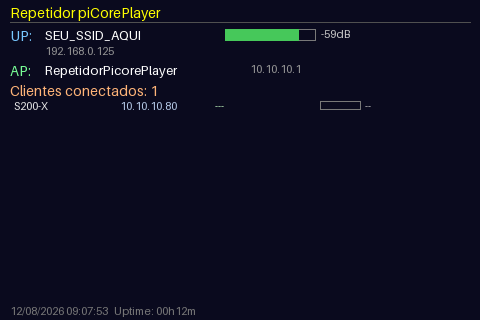

# Repetidor Wi-Fi com piCorePlayer (Raspberry Pi 3 + Zero W)

[](https://github.com/m33600/picoreplayer-wifi-repeater)
[](LICENSE)
[](https://github.com/m33600/picoreplayer-wifi-repeater)

Repositório: [github.com/m33600/picoreplayer-wifi-repeater](https://github.com/m33600/picoreplayer-wifi-repeater)

Receita completa para transformar um Raspberry Pi num repetidor Wi-Fi
rodando [piCorePlayer](https://www.picoreplayer.org/) (Tiny Core Linux).
Duas variantes testadas:

- **Pi 3** — com tela TFT SPI mostrando status ao vivo (uplink, AP,
  clientes conectados, sinal, tráfego, uptime)
- **Zero W** — versão mais simples/portátil, sem tela, mesma lógica de
  repetidor



*Captura exata do frame renderizado por `pcp-status-display.py` no Pi 3
(gerada chamando a própria função de desenho do script, não uma foto da
tela física).*

## Ambas as variantes precisam de dois rádios Wi-Fi

Repetidor Wi-Fi "de verdade" (sem cabo) precisa de **dois rádios** — um
cliente (STA) e um AP — porque não dá pra fazer bridge de camada 2 entre
duas interfaces Wi-Fi (limitação do formato de frame 802.11). Por isso o
tráfego passa por **NAT**, não por bridge. Em ambas as placas usamos:
chip Wi-Fi interno como **AP**, um dongle USB como **uplink**.

**Antes de decidir qual dongle faz qual papel**, confira o suporte real a
modo AP do driver com `iw phy <phyN> info | grep -A5 "Supported interface
modes"` — muita placa "genérica" USB só lista `managed`/`monitor` (sem
`AP`), então só serve pro papel de uplink/cliente. Foi assim que
descobrimos que o MT7601U não serve como AP (driver mainline `mt7601u`
nunca implementou modo AP), mas serve perfeitamente como uplink. Também
já testamos dois dongles Ralink (`rt2800usb`: RT2870 e RT73) como AP —
ambos tinham bugs reais nesse papel (travava com certos clientes, ou
beacon no ar sem passar tráfego). O **chip Wi-Fi interno como AP** foi o
único candidato 100% estável nos nossos testes em ambas as placas.

## Por que não usar o `pcp-apmode` pronto

O piCorePlayer tem uma extensão oficial (`pcp-apmode.tcz`) para modo AP,
mas o script dela (`/usr/local/bin/pcp-apmode`) vem com `wlan0` e `eth0`
**fixos no código** — ela assume que o AP é sempre `wlan0` e o uplink é
sempre `eth0` (cabo). Isso não serve para o cenário de dois rádios Wi-Fi
(uplink sem fio). Solução usada nas duas variantes: usar os mesmos
binários que essa extensão traz como dependência (`hostapd`, `dnsmasq`,
`iptables`) mas com um script próprio (`pcp-repeater-start.sh`).

---

## Variante 1: Raspberry Pi 3 (com tela TFT)

### Hardware

- Raspberry Pi 3 Model B
- Tela **Waveshare 3.5" RPi LCD (A)** — controlador **ILI9486**, touch **XPT2046**
- Dongle USB Wi-Fi **MediaTek MT7601U** (uplink)
- Wi-Fi interno do Pi 3 (chip Broadcom, driver `brcmfmac`, suporta 802.11n) — AP

### Topologia

```
Rede existente (ex: roteador de casa)
        |  (Wi-Fi, modo cliente/STA)
     wlan1 (dongle MT7601U)
        |
   [Raspberry Pi 3 / piCorePlayer]
        |
     wlan0 (chip interno, modo AP via hostapd)
        |  (Wi-Fi, SSID do repetidor)
   Dispositivos clientes
```

### A tela: por que driver em userspace

O overlay de device tree `piscreen` (usado por várias telas TFT SPI,
inclusive clones da Waveshare 3.5" A) carrega normalmente, mas **não
existe o módulo de kernel `fbtft`** em nenhuma versão do piCorePlayer
(32 nem 64 bits) — o kernel Linux vem descontinuando esse framework desde
a 5.4. Sem esse driver, `/dev/fb1` nunca é criado.

Solução: desenhar direto na tela via SPI em **userspace**, com Python +
[`pyili9486`](https://github.com/SirLefti/Python_ILI9486) + `spidev` +
`lgpio`, sem depender de nenhum driver de kernel.

Pinout real (lido diretamente do device tree aplicado, `piscreen@0`):

| Sinal | GPIO |
|---|---|
| DC (data/command) | 24 |
| RESET | 25 |
| Backlight | 22 |
| Touch IRQ (não usado ainda) | 17 |

### Passo a passo

**1. Gravar a imagem** — piCorePlayer 64-bit (Pi 3/4):

```sh
xzcat piCorePlayer-XX.X.X-64Bit.img.xz | sudo dd of=/dev/mmcblkX bs=4M status=progress conv=fsync
```

**2. Configurar a tela** (partição de boot, FAT32) — ver
`config/pi3/config.txt` para o arquivo completo, trecho relevante:

```
dtparam=spi=on
dtoverlay=piscreen,speed=24000000
```

Editar `config/pi3/cmdline.txt` (mesma partição), acrescentando ao final
da linha única existente:

```
fbcon=map:10 fbcon=font:VGA8x8
```

**3. Configurar o Wi-Fi de uplink** — copiar
`config/pi3/wpa_supplicant.conf.example` para `wpa_supplicant.conf` na
partição de boot, preenchendo `ssid`/`psk` reais.

Como o uplink é num dongle USB (`wlan1`, não o chip interno), é preciso
impedir que o piCorePlayer suba `wpa_supplicant` sozinho no `wlan0` no
boot (ele faz isso incondicionalmente quando `WIFI="on"`). Editar
`/usr/local/etc/pcp/pcp.cfg`:

```
WIFI="off"
```

O uplink em `wlan1` é então iniciado manualmente dentro do
`pcp-repeater-start.sh`, reaproveitando o mecanismo genérico do próprio
piCorePlayer:

```sh
/usr/local/etc/init.d/wifi wlan1 start
```

(esse script aceita `wlan0` ou `wlan1` como parâmetro e já cuida do
`wpa_supplicant` + DHCP — só o `pcp_startup.sh` que vem com `wlan0`
fixo no código).

**4. Instalar Python e dependências da tela** (via SSH, depois do boot):

```sh
tce-load -wi python3.11.tcz python3.11-pip.tcz python3.11-dev.tcz python3.11-rpi-gpio.tcz compiletc.tcz
python3.11 -m pip install spidev pillow 'pyili9486[lgpio]'
```

**5. Instalar as dependências do repetidor**:

```sh
tce-load -wi pcp-apmode.tcz iw.tcz
```
(isso já traz `hostapd`, `dnsmasq`, `iptables`, `bridge-utils` como
dependência — não é necessário usar o `pcp-apmode` em si).

**6. Configurar hostapd/dnsmasq** — editar
`/usr/local/etc/pcp/hostapd.conf` e `/usr/local/etc/pcp/dnsmasq.conf`
conforme `config/pi3/hostapd.conf` e `config/pi3/dnsmasq.conf` — SSID
no AP (chip interno, que suporta 802.11n), vale habilitar:

```
ieee80211n=1
ht_capab=[HT40][SHORT-GI-20][DSSS_CCK-40]
```

Se o AP for num dongle sem suporte a "n" (ex: RT73, só b/g), deixar
`ieee80211n=0` — senão o `hostapd` falha ao subir com
`Could not set channel for kernel driver`.

**7. Scripts de inicialização** — copiar `scripts/pi3/pcp-repeater-start.sh`
e `scripts/pi3/pcp-status-display.py` para `/opt/` no Pi (⚠️ **não** usar
`/usr/local/bin` — no Tiny Core, `/usr/local` é reconstruído do zero a
cada boot a partir das extensões `.tcz`; só `/opt`, `/home` e alguns
caminhos específicos de `/usr/local/etc/pcp` sobrevivem via backup).

`pcp-repeater-start.sh` já cuida de subir o uplink (`wlan1`) antes de
configurar o AP (`wlan0`) e o NAT — ajustar as variáveis
`UPLINK`/`APIF` no topo conforme qual interface faz qual papel.

Chamar os dois scripts a partir do `/opt/bootlocal.sh` (ver
`config/pi3/bootlocal.sh`), com espera pela interface de uplink existir
antes de iniciar o repetidor.

**8. Persistir**:

```sh
sudo filetool.sh -b
```

### Validação (Pi 3)

Testado em 12/08/2026, depois de todas as mudanças (troca de papéis das
interfaces incluída):

- `hostapd`, `dnsmasq`, `wpa_supplicant` e `pcp-status-display.py` rodando
  havia ~23 minutos sem reiniciar (mesmos PIDs desde o último boot, sem
  crashes)
- Cliente real conectado e estável durante todo o período
- Teste de ponta a ponta (gateway do AP → internet via NAT): **0% de
  perda de pacote**

---

## Variante 2: Raspberry Pi Zero W (sem tela, mais simples)

### Hardware

- Raspberry Pi Zero W
- Dongle USB Wi-Fi **Ralink RT73** (uplink) — a única porta USB OTG do
  Zero W fica ocupada com ele
- Wi-Fi interno do Zero W (mesma família de chip Broadcom, suporta 802.11n) — AP

### Topologia

```
Rede existente (ex: roteador de casa)
        |  (Wi-Fi, modo cliente/STA)
     wlan1 (dongle RT73, na unica porta USB OTG)
        |
   [Raspberry Pi Zero W / piCorePlayer]
        |
     wlan0 (chip interno, modo AP via hostapd)
        |  (Wi-Fi, SSID do repetidor)
   Dispositivos clientes
```

### Diferenças importantes em relação ao Pi 3

- **Sem tela** — essa variante não inclui a parte de driver/tela TFT.
- **Imagem 32-bit, não 64-bit** — o Zero W é ARMv6 (mesma família do Pi 1
  original). A imagem 64-bit do piCorePlayer **não** suporta Pi Zero
  (`# RPi PI0-1-2 are not supported on this image` no `config.txt` da
  imagem 64-bit). Baixar a versão 32-bit.
- **Só uma porta USB (OTG)** — não tem folga de hardware para múltiplos
  dongles sem um hub USB.
- Hardware mais fraco (single-core ARM11 ~1GHz, 512MB RAM) — o repetidor
  funciona bem, mas com latência mais alta que o Pi 3.

### Passo a passo

O processo é o mesmo do Pi 3, sem a parte da tela (pular passos 2 e 4):

**1. Gravar a imagem 32-bit**:

```sh
xzcat piCorePlayer-XX.X.X.img.xz | sudo dd of=/dev/mmcblkX bs=4M status=progress conv=fsync
```

**2. Configurar o Wi-Fi de uplink** — mesmo processo do Pi 3, copiar
`config/zero-w/wpa_supplicant.conf.example` para `wpa_supplicant.conf`
na partição de boot.

**3. Instalar as dependências do repetidor**:

```sh
tce-load -wi pcp-apmode.tcz iw.tcz
```

**4. Configurar hostapd/dnsmasq** — conforme `config/zero-w/hostapd.conf`
e `config/zero-w/dnsmasq.conf` deste repo (mesma lógica do Pi 3:
`interface=wlan0` pro AP no chip interno, `ieee80211n=1` +
`ht_capab=[HT40][SHORT-GI-20][DSSS_CCK-40]` já que o chip interno do
Zero W também suporta 802.11n).

**5. Scripts de inicialização** — copiar
`scripts/zero-w/pcp-repeater-start.sh` para `/opt/` e chamar a partir do
`/opt/bootlocal.sh` (ver `config/zero-w/bootlocal.sh`). Mesmas variáveis
`UPLINK=wlan1` / `APIF=wlan0`.

**6. Persistir**:

```sh
sudo filetool.sh -b
```

### Pegadinha específica do Zero W: placa detectada como modelo errado

Numa das placas testadas, o Wi-Fi interno simplesmente não aparecia como
interface de rede — nem em `ifconfig -a`, nem em `lsmod`. Diagnóstico:

```sh
cat /proc/device-tree/model
# → "Raspberry Pi Model B Rev 2"  (era pra ser "Raspberry Pi Zero W")
```

O firmware estava detectando a placa errado e carregando o device tree
do Model B original (2012), que genuinamente não tem nó de Wi-Fi. Testamos
forçar o device tree certo:

```
# primeira linha do config.txt
device_tree=bcm2708-rpi-zero-w.dtb
```

Isso corrigiu o device tree (o nó SDIO do Wi-Fi passou a existir), mas o
Wi-Fi *ainda* não funcionava — o log mostrava:

```
mmc1: Failed to initialize a non-removable card
```

Esse é o barramento SDIO que conecta ao chip de Wi-Fi. A conclusão foi
**defeito real de hardware nessa placa específica** (chip Wi-Fi morto ou
solda com problema — a placa era de 2017), não algo corrigível por
software. Trocamos para outra unidade Zero W e funcionou de primeira,
com `/proc/device-tree/model` mostrando corretamente "Raspberry Pi Zero W
Rev 1.1". Vale testar isso **antes** de gastar tempo depurando
configuração, se uma placa Zero W não mostrar a interface Wi-Fi interna.

### Validação (Zero W)

Testado em 12/08/2026, sobrevivendo a dois reboots completos:

- `hostapd`, `dnsmasq` e `wpa_supplicant` sobem sozinhos no boot
- Teste de ponta a ponta (gateway do AP → internet via NAT): **0% de
  perda de pacote** (latência mais alta que o Pi 3, ~100-700ms —
  esperado pelo hardware mais fraco)

Checagem de estabilidade em separado, depois de ~82 minutos rodando:

- `hostapd`, `dnsmasq` e `wpa_supplicant` com os mesmos PIDs desde o
  setup — nenhum reiniciou sozinho
- IP do uplink mudou (reatribuição normal de DHCP do roteador de casa) —
  não afeta o repetidor, só o endereço usado pra alcançá-lo por SSH
- Novo teste de ponta a ponta: **0% de perda de pacote** de novo

---

## Pegadinhas gerais (ambas as placas)

- **PATH em sessão SSH não-interativa não inclui `/usr/local/sbin` nem
  `/usr/local/bin`** — `iptables`, `iw`, `iwconfig` etc. dão "not found"
  a menos que se use o caminho completo ou exporte o PATH manualmente.
- **`pkill -f <padrão>` pode se automatar** — se o próprio comando SSH
  contém o texto do padrão como argumento, o `pkill` bate no processo do
  próprio comando e mata a sessão antes de qualquer saída (erro 255 sem
  mensagem nenhuma). Usar `killall <nome-do-processo>` em vez disso.
- **`pip install --user`** (padrão quando não é root) instala em
  `~/.local/...` — se o processo que usa essas libs depois roda como
  root (ex: via `bootlocal.sh`), precisa `HOME=/home/tc` explícito na
  chamada, senão dá `ModuleNotFoundError`.
- **`dnsmasq` precisa de `/var/lib/misc` existir** para o arquivo de
  leases — não é criado automaticamente.
- **Sistema roda em UTC sem tzdata** — mais simples aplicar offset fixo
  no próprio script Python do que instalar timezone database (Brasil não
  tem horário de verão desde 2019, então um offset fixo é seguro).
- **Cuidado ao trocar qual interface é uplink vs AP por SSH**: se você
  estiver conectado via SSH pela própria interface que vai virar AP
  (ex: `wlan0`), matar o `wpa_supplicant`/`dhcpcd` dela **corta sua
  própria sessão** no meio da reconfiguração — e você perde acesso antes
  de terminar. Jeito seguro: preparar **todas** as mudanças de config só
  em arquivos (sem matar nenhum processo ao vivo) e aplicar tudo de uma
  vez com um único reboot controlado no final. Se algo não foi
  persistido ainda (`filetool.sh -b`), um religamento de energia volta
  pro último estado salvo — rede de segurança de graça.
- **Board detectada como modelo errado** (Zero W → "Model B Rev 2"):
  ver seção específica acima. Vale checar `cat /proc/device-tree/model`
  logo de cara se uma interface de rede esperada não aparecer.

## Créditos

- [piCorePlayer](https://www.picoreplayer.org/) / [Tiny Core Linux](http://tinycorelinux.net/)
- [pyili9486](https://github.com/SirLefti/Python_ILI9486) — driver ILI9486 em userspace
